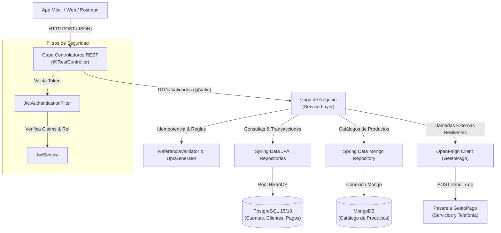
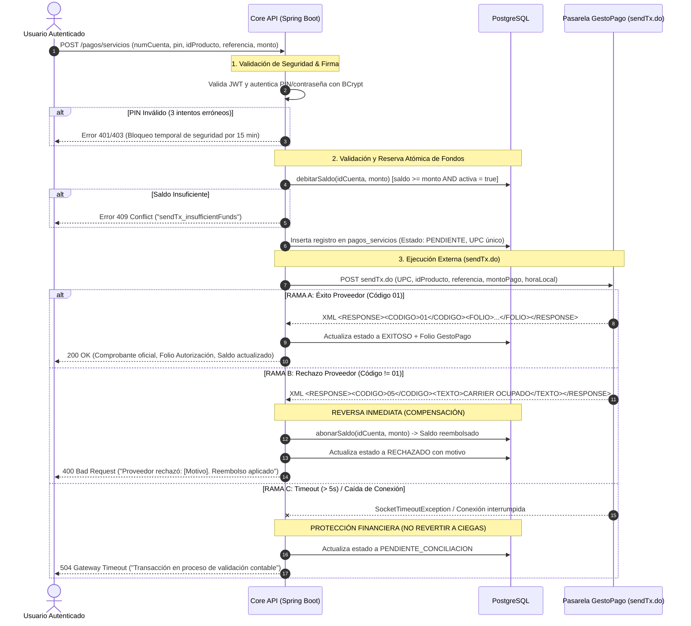
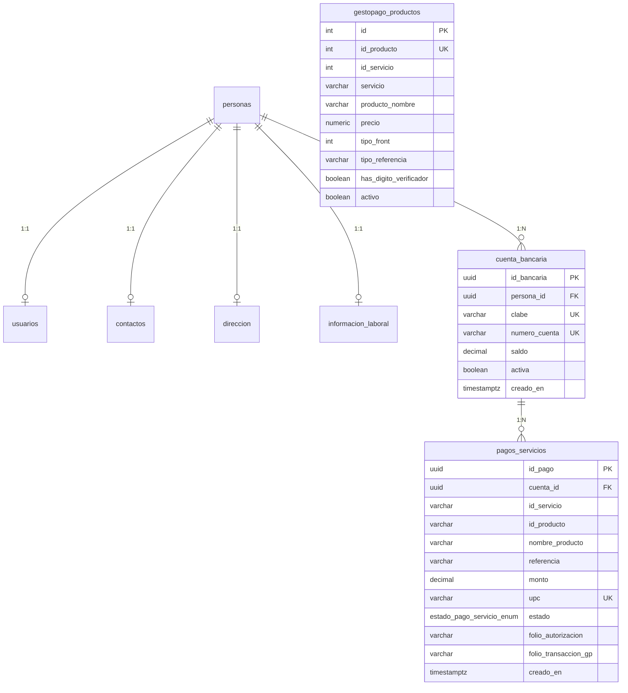

# 🏦 Core Bancario & Pasarela de Pagos de Servicios — API REST

[](https://spring.io/projects/spring-boot)
[](https://www.oracle.com/java/)
[](https://www.postgresql.org/)
[](https://www.mongodb.com/)
[](https://flywaydb.org/)
[](https://spring.io/projects/spring-security)
[-success.svg)]()

Microservicio bancario de alta disponibilidad y consistencia contable construido con **Spring Boot**. Provee la gestión integral de clientes, cuentas bancarias CLABE, autenticación segura basada en tokens JWT con control de acceso por roles (RBAC), y una pasarela transaccional de pagos de servicios públicos, telefonía móvil y pines digitales integrada con el proveedor **GestoPago (`sendTx.do`)**.

---

## 📌 Tabla de Contenidos

- [1. Stack Tecnológico](#1-stack-tecnológico)
- [2. Arquitectura del Sistema](#2-arquitectura-del-sistema)
- [3. Módulo Transaccional de Pagos de Servicios (GestoPago)](#3-módulo-transaccional-de-pagos-de-servicios-gestopago)
  - [3.1 Patrón Financiero: Reserva con Compensación Inmediata (Two-Phase Rollback)](#31-patrón-financiero-reserva-con-compensación-inmediata-two-phase-rollback)
  - [3.2 Validación Dinámica por tipoFront](#32-validación-dinámica-por-tipofront)
  - [3.3 Idempotencia con UPC Criptográfico](#33-idempotencia-con-upc-criptográfico)
  - [3.4 Tareas Programadas (CRON)](#34-tareas-programadas-cron)
- [4. Seguridad y Reglas de Negocio (RBAC)](#4-seguridad-y-reglas-de-negocio-rbac)
- [5. Catálogo de Endpoints REST](#5-catálogo-de-endpoints-rest)
- [6. Modelo de Datos y Migraciones Flyway (V1 — V9)](#6-modelo-de-datos-y-migraciones-flyway-v1--v9)
- [7. Guía de Configuración y Ejecución](#7-guía-de-configuración-y-ejecución)
- [8. Despliegue en la Nube (Docker & Render)](#8-despliegue-en-la-nube-docker--render)
- [9. Pruebas y Calidad de Código](#9-pruebas-y-calidad-de-código)

---

## 1. Stack Tecnológico

| Capa / Componente | Tecnología | Versión | Propósito |
|:---|:---|:---:|:---|
| **Lenguaje & Runtime** | Java OpenJDK | 17 LTS / 22 | Runtime base de alto rendimiento |
| **Framework Principal** | Spring Boot | 3.3.6 | Inversión de control, inyección de dependencias y web MVC |
| **Seguridad** | Spring Security + JJWT | 6.3.x / 0.12.6 | Autenticación Bearer JWT, encriptación BCrypt y RBAC |
| **Persistencia Relacional** | Hibernate (JPA) + HikariCP | 6.5.3 / 5.1.0 | ORM transaccional y pool de conexiones para PostgreSQL |
| **Base de Datos Principal** | PostgreSQL | 15 / 16 / 18 | Motor relacional ACID para clientes, cuentas y pagos |
| **Base de Datos NoSQL** | MongoDB (Spring Data Mongo) | 5.0.x | Almacenamiento ágil del catálogo de productos GestoPago |
| **Evolución de BD** | Flyway | 10.x | Versionado automatizado de esquemas DDL (Migraciones V1 a V9) |
| **Integración HTTP Externa**| Spring Cloud OpenFeign | 4.1.4 | Clientes declarativos HTTP hacia GestoPago (`sendTx.do`) |
| **Serialización / Deserialización**| Jackson + JAXB (Jakarta XML) | 2.17.x / 4.x | Mapeo bidireccional JSON REST y XML del proveedor |
| **Validaciones** | Jakarta Bean Validation (Hibernate Validator) | 8.0.x | Reglas de entrada estrictas en Request Bodies |
| **Documentación Interactiva**| SpringDoc OpenAPI (Swagger UI) | 2.2.0 | Documentación interactiva disponible en `/swagger-ui/index.html` |
| **Testing** | JUnit 5 + Mockito + Spring Test | 5.10.x | Pruebas unitarias, de integración y WebMvc |
| **Contenedores & Despliegue**| Docker + Render Cloud | — | Despliegue contenerizado multi-etapa |

---

## 2. Arquitectura del Sistema

La solución adopta una **Arquitectura en Capas (Layered Architecture)** con estricta segregación de responsabilidades y contratos de negocio:



---

## 3. Módulo Transaccional de Pagos de Servicios (GestoPago)

### 3.1 Patrón Financiero: Reserva con Compensación Inmediata (Two-Phase Rollback)

En operaciones financieras conectadas a proveedores externos, **nunca se descuenta el saldo después** (riesgo de fuga de capital por saldo insuficiente sobrevenido) ni se descuenta antes sin reversa automática. El sistema aplica el patrón bancario de **Reserva con Compensación Inmediata**:



### 3.2 Validación Dinámica por `tipoFront`

El catálogo clasifica los productos a través de `tipoFront` y `tipoReferencia`:

| `tipoFront` | Tipo de Servicio | Formato de Referencia | Regla de Validación en Backend |
|:---:|:---|:---|:---|
| **`1`** | **Telefonía / Recargas** (Telcel, Movistar, AT&T) | Celular 10 dígitos | Regex estricta `^\d{10}$`. Rechaza letras, espacios o códigos de país. |
| **`2`** | **Servicios Públicos** (CFE, Telmex, Agua, Gas) | Número de servicio / Código de barras | Rango de 4 a 50 caracteres. Algoritmo de **Luhn / Módulo 10** si `hasDigitoVerificador = true`. |
| **`40`** | **Transferencias y Remesas** | Tarjeta de débito o CLABE | Valida 16 dígitos (algoritmo de Luhn) o 18 dígitos (dígito de control CLABE con ponderación 3-7-1). |
| **`4`** | **Consulta de Saldo** | Número de contrato | Obtiene saldo adeudo previo a la liquidación. |
| **`5` / `30`** | **Pines Digitales** (Netflix, Amazon, Uber) | Referencia de cliente | Emisión de código electrónico / PIN de canje. |

### 3.3 Idempotencia con UPC Criptográfico

Para evitar dobles cargos por reintentos de red, el componente `UpcGenerator` crea de forma autónoma una clave de idempotencia de **10 caracteres alfanuméricos** (`0-9`, `A-Z`) generada con `SecureRandom` ($36^{10} \approx 3.65 \times 10^{15}$ combinaciones únicas), la cual viaja a GestoPago en el parámetro `upc`.

### 3.4 Tareas Programadas (CRON)

- **`GestoPagoTokenRefreshTask`:** Corre automáticamente cada 60 minutos (`fixedRate = 3600000 ms`). Renueva y almacena el token Bearer en la tabla `gestopago_tokens` para garantizar que ninguna transacción falle por token vencido.
- **`GestoPagoCatalogSyncTask`:** Corre diariamente a medianoche (`gestopago.sync.cron = 0 0 0 * * ?`). Descarga productos desde `getProductList.do` y sincroniza bidireccionalmente PostgreSQL y MongoDB, aplicando filtros de integridad y sanitización de anomalías.

---

## 4. Seguridad y Reglas de Negocio (RBAC)

1. **Aislamiento de Cuentas (Prevención de IDOR / BOLA):**
   - Un usuario con rol `ROLE_USER` **únicamente** puede consultar cuentas, saldos e historial de pagos que pertenezcan a su propia identidad. El correo se extrae directamente del JWT autenticado, nunca de la URL.
   - Un usuario con rol `ROLE_ADMIN` puede consultar auditorías globales e historiales de cualquier cuenta.
2. **Firma Obligatoria de Operaciones (PIN de Autorización):**
   - Antes de cualquier débito, el usuario debe firmar con su contraseña.
   - Si falla, se incrementa `intentosFallidos`. Al 3er intento erróneo consecutivo, la cuenta de usuario se bloquea automáticamente por 15 minutos (`USUARIO_BLOQUEADO`).
3. **Protección Anti-Doble Gasto:**
   - La actualización de saldo se realiza a nivel atómico en SQL:  
     `UPDATE cuenta_bancaria SET saldo = saldo - :monto WHERE id_bancaria = :id AND saldo >= :monto AND activa = true`.
   - Si dos hilos concurrentes intentan gastar el mismo dinero, la base de datos garantiza que el segundo hilo afecte 0 filas y sea rechazado con `sendTx_insufficientFunds`.
4. **Directiva de Cero Parámetros en URL:**
   - Todas las búsquedas, filtros y transacciones se envían estrictamente mediante `@Valid @RequestBody` en JSON (cero `@PathVariable` y cero `@RequestParam`).

---

## 5. Catálogo de Endpoints REST

Todas las respuestas exitosas y de error están estandarizadas bajo el formato `GenericResponse`:
```json
{
  "codigo": 0,
  "mensaje": "Operación exitosa.",
  "datos": { ... }
}
```

### 5.1 Pagos de Servicios (`/pagos/servicios`)

| Método | Endpoint | Body DTO | Roles Permitidos | Descripción |
|:---:|:---|:---|:---:|:---|
| `POST` | `/pagos/servicios` | `PagoServicioRequest` | `ROLE_USER`, `ROLE_ADMIN` | Procesa el pago de servicio con reserva y rollback inmediato. |
| `POST` | `/pagos/servicios/historial` | `PagoBusquedaRequest` | `ROLE_USER`, `ROLE_ADMIN` | Consulta paginada del historial de pagos con filtros combinables. |

**Ejemplo de Petición (`POST /pagos/servicios`):**
```json
{
  "numCuenta": "12345678901234567890",
  "pinAutorizacion": "MiContraseñaSegura123",
  "idServicio": "1",
  "idProducto": "11",
  "referencia": "5512345678",
  "monto": 100.00
}
```

### 5.2 Cuentas Bancarias (`/cuentas`)

| Método | Endpoint | Body DTO | Roles Permitidos | Descripción |
|:---:|:---|:---|:---:|:---|
| `POST` | `/cuentas/buscar` | `CuentaBusquedaRequest` | `ROLE_USER`, `ROLE_ADMIN` | Búsqueda paginada de cuentas bancarias. |
| `POST` | `/cuentas/saldo` | `CuentaConsultaRequest` | `ROLE_USER`, `ROLE_ADMIN` | Consulta de saldo disponible de una cuenta. |
| `POST` | `/cuentas/depositar` | `CuentaDepositoRequest` | `ROLE_USER`, `ROLE_ADMIN` | Agrega fondos (depósito de saldo) a una cuenta activa. |

### 5.3 Autenticación y Usuarios (`/auth`, `/usuarios`)

| Método | Endpoint | Body DTO | Roles Permitidos | Descripción |
|:---:|:---|:---|:---:|:---|
| `POST` | `/auth/login` | `LoginRequest` | **Público** | Genera token JWT de sesión (`FULL` o `RECOVERY`). |
| `GET` | `/usuarios/me` | — | `ROLE_USER`, `ROLE_ADMIN` | Obtiene el perfil del usuario autenticado. |
| `PUT` | `/usuarios/me/password` | `CambioPasswordRequest` | `ROLE_USER`, `ROLE_ADMIN` | Actualiza la contraseña del usuario autenticado. |
| `PUT` | `/usuarios/me/reactivar` | — | `ROLE_RECOVERY` | Reactiva una cuenta desactivada. |

### 5.4 Clientes (`/clientes`)

| Método | Endpoint | Body DTO | Roles Permitidos | Descripción |
|:---:|:---|:---|:---:|:---|
| `POST` | `/clientes` | `ClienteRequest` | **Público** | Registro transaccional de cliente + cuenta bancaria CLABE. |
| `GET` | `/clientes/me` | — | `ROLE_USER`, `ROLE_ADMIN` | Consulta los datos personales del cliente en sesión. |
| `POST` | `/clientes/buscar` | `ClienteBusquedaRequest` | `ROLE_ADMIN` | Búsqueda administrativa avanzada de clientes. |

---

## 6. Modelo de Datos y Migraciones Flyway (V1 — V9)

El esquema relacional en PostgreSQL está versionado con Flyway:



### Historial de Migraciones:
- `V1`: Creación de tabla `gestopago_tokens` para persistencia de tokens Bearer.
- `V2`: Creación de tabla base de `personas`.
- `V3`: Creación de catálogo relacional `gestopago_productos`.
- `V4`: Esquema bancario transaccional (`cuenta_bancaria`, `usuarios`, `contactos`, `direccion`).
- `V5`: Fortalecimiento de restricciones de unicidad y validación de CURP/RFC.
- `V6`: Control de seguridad, intentos fallidos y fechas de bloqueo en `usuarios`.
- `V7`: Adición del rol de seguridad (`rol = 'ROLE_USER' / 'ROLE_ADMIN'`).
- `V8`: Flexibilización de `apellido_materno` como opcional.
- **`V9` (Actual):** Creación del enum `estado_pago_servicio_enum`, tabla `pagos_servicios` y actualización de `gestopago_productos` con `tipo_front`, `tipo_referencia` y `has_digito_verificador`.

---

## 7. Guía de Configuración y Ejecución

### 7.1 Variables de Entorno

| Variable | Descripción | Valor por Defecto Local |
|:---|:---|:---|
| `DB_HOST` | Host del servidor PostgreSQL | `localhost` |
| `DB_PORT` | Puerto de PostgreSQL | `5432` |
| `DB_NAME` | Nombre de la base de datos | `EnviromentProject` |
| `DB_USERNAME` | Usuario de PostgreSQL | `postgres` |
| `DB_PASSWORD` | Contraseña de PostgreSQL | *(definir en local)* |
| `MONGODB_URI` | URI de conexión a MongoDB | `mongodb://localhost:27017/EnviromentProject` |
| `JWT_SECRET` | Clave secreta HMAC para firmar tokens JWT | *(mínimo 32 bytes aleatorios)* |
| `BANK_CLABE_INSTITUTION_CODE` | Código bancario de 3 dígitos para CLABE | `001` |
| `BANK_CLABE_PLAZA_CODE` | Código de plaza de 3 dígitos para CLABE | `180` |
| `GESTOPAGO_PASSWORD` | Contraseña del dispositivo en GestoPago | *(secreto en Render/Local)* |
| `GESTOPAGO_STATIC_TOKEN` | Token estático alternativo de GestoPago | *(opcional)* |

### 7.2 Ejecución en Local con Gradle

1. **Generar secreto JWT y levantar en Windows PowerShell:**
   ```powershell
   $bytes = New-Object byte[] 32
   $rng = [System.Security.Cryptography.RandomNumberGenerator]::Create()
   $rng.GetBytes($bytes)
   $env:JWT_SECRET = [Convert]::ToBase64String($bytes)
   $rng.Dispose()

   .\gradlew.bat bootRun
   ```

2. **Ejecutar Suite de Pruebas Unitarias:**
   ```bash
   ./gradlew test
   ```

---

## 8. Despliegue en la Nube (Docker & Render)

El proyecto incluye un `Dockerfile` multi-etapa optimizado para producción:

```dockerfile
# Compilación
FROM gradle:8.8-jdk17 AS build
WORKDIR /app
COPY . .
RUN gradle bootJar --no-daemon

# Ejecución
FROM openjdk:17-slim
WORKDIR /app
COPY --from=build /app/build/libs/*.jar app.jar
EXPOSE 8080
ENTRYPOINT ["java", "-jar", "app.jar"]
```

### Despliegue continuo con `render.yaml` (Blueprint):
1. Conecta el repositorio en Render mediante **New → Blueprint**.
2. Render aprovisionará el servicio web Docker y la base de datos PostgreSQL administrada.
3. El puerto se mapea dinámicamente mediante la variable `$PORT` y el health check responde en `/actuator/health`.

---

## 9. Pruebas y Calidad de Código

El proyecto cuenta con una cobertura integral de pruebas automatizadas:
- **Pruebas de Validación:** Validadores de CURP, RFC, CLABE oficial y validador dinámico `tipoFront`.
- **Pruebas de Idempotencia:** Generación de 1,000 UPCs simultáneos sin colisiones.
- **Pruebas de Integración con Mocks:** Simulación de respuestas XML de aprobación (`01`), rechazos de carrier (`05`) y timeouts de red.
- **Pruebas de Rollback:** Verificación de compensación y abono inmediato ante rechazos del proveedor.

Para ejecutar el reporte de pruebas:
```bash
./gradlew test jacocoTestReport
```
Los resultados quedan disponibles en: `build/reports/tests/test/index.html`.

Para evitar dobles cargos por reintentos de red, el componente `UpcGenerator` crea de forma autónoma una clave de idempotencia de **10 caracteres alfanuméricos** (`0-9`, `A-Z`) generada con `SecureRandom` ($36^{10} \approx 3.65 \times 10^{15}$ combinaciones únicas), la cual viaja a GestoPago en el parámetro `upc`.

### 3.4 Tareas Programadas (CRON)

- **`GestoPagoTokenRefreshTask`:** Corre automáticamente cada 60 minutos (`fixedRate = 3600000 ms`). Renueva y almacena el token Bearer en la tabla `gestopago_tokens` para garantizar que ninguna transacción falle por token vencido.
- **`GestoPagoCatalogSyncTask`:** Corre diariamente a medianoche (`gestopago.sync.cron = 0 0 0 * * ?`). Descarga productos desde `getProductList.do` y sincroniza bidireccionalmente PostgreSQL y MongoDB, aplicando filtros de integridad y sanitización de anomalías.

---

## 4. Seguridad y Reglas de Negocio (RBAC)

1. **Aislamiento de Cuentas (Prevención de IDOR / BOLA):**
   - Un usuario con rol `ROLE_USER` **únicamente** puede consultar cuentas, saldos e historial de pagos que pertenezcan a su propia identidad. El correo se extrae directamente del JWT autenticado, nunca de la URL.
   - Un usuario con rol `ROLE_ADMIN` puede consultar auditorías globales e historiales de cualquier cuenta.
2. **Firma Obligatoria de Operaciones (PIN de Autorización):**
   - Antes de cualquier débito, el usuario debe firmar con su contraseña.
   - Si falla, se incrementa `intentosFallidos`. Al 3er intento erróneo consecutivo, la cuenta de usuario se bloquea automáticamente por 15 minutos (`USUARIO_BLOQUEADO`).
3. **Protección Anti-Doble Gasto:**
   - La actualización de saldo se realiza a nivel atómico en SQL:  
     `UPDATE cuenta_bancaria SET saldo = saldo - :monto WHERE id_bancaria = :id AND saldo >= :monto AND activa = true`.
   - Si dos hilos concurrentes intentan gastar el mismo dinero, la base de datos garantiza que el segundo hilo afecte 0 filas y sea rechazado con `sendTx_insufficientFunds`.
4. **Directiva de Cero Parámetros en URL:**
   - Todas las búsquedas, filtros y transacciones se envían estrictamente mediante `@Valid @RequestBody` en JSON (cero `@PathVariable` y cero `@RequestParam`).

---

## 5. Catálogo de Endpoints REST

Todas las respuestas exitosas y de error están estandarizadas bajo el formato `GenericResponse`:
```json
{
  "codigo": 0,
  "mensaje": "Operación exitosa.",
  "datos": { ... }
}
```

### 5.1 Pagos de Servicios (`/pagos/servicios`)

| Método | Endpoint | Body DTO | Roles Permitidos | Descripción |
|:---:|:---|:---|:---:|:---|
| `POST` | `/pagos/servicios` | `PagoServicioRequest` | `ROLE_USER`, `ROLE_ADMIN` | Procesa el pago de servicio con reserva y rollback inmediato. |
| `POST` | `/pagos/servicios/historial` | `PagoBusquedaRequest` | `ROLE_USER`, `ROLE_ADMIN` | Consulta paginada del historial de pagos con filtros combinables. |

**Ejemplo de Petición (`POST /pagos/servicios`):**
```json
{
  "numCuenta": "12345678901234567890",
  "pinAutorizacion": "MiContraseñaSegura123",
  "idServicio": "1",
  "idProducto": "11",
  "referencia": "5512345678",
  "monto": 100.00
}
```

### 5.2 Cuentas Bancarias (`/cuentas`)

| Método | Endpoint | Body DTO | Roles Permitidos | Descripción |
|:---:|:---|:---|:---:|:---|
| `POST` | `/cuentas/buscar` | `CuentaBusquedaRequest` | `ROLE_USER`, `ROLE_ADMIN` | Búsqueda paginada de cuentas bancarias. |
| `POST` | `/cuentas/saldo` | `CuentaConsultaRequest` | `ROLE_USER`, `ROLE_ADMIN` | Consulta de saldo disponible de una cuenta. |
| `POST` | `/cuentas/depositar` | `CuentaDepositoRequest` | `ROLE_USER`, `ROLE_ADMIN` | Agrega fondos (depósito de saldo) a una cuenta activa. |

### 5.3 Autenticación y Usuarios (`/auth`, `/usuarios`)

| Método | Endpoint | Body DTO | Roles Permitidos | Descripción |
|:---:|:---|:---|:---:|:---|
| `POST` | `/auth/login` | `LoginRequest` | **Público** | Genera token JWT de sesión (`FULL` o `RECOVERY`). |
| `GET` | `/usuarios/me` | — | `ROLE_USER`, `ROLE_ADMIN` | Obtiene el perfil del usuario autenticado. |
| `PUT` | `/usuarios/me/password` | `CambioPasswordRequest` | `ROLE_USER`, `ROLE_ADMIN` | Actualiza la contraseña del usuario autenticado. |
| `PUT` | `/usuarios/me/reactivar` | — | `ROLE_RECOVERY` | Reactiva una cuenta desactivada. |

### 5.4 Clientes (`/clientes`)

| Método | Endpoint | Body DTO | Roles Permitidos | Descripción |
|:---:|:---|:---|:---:|:---|
| `POST` | `/clientes` | `ClienteRequest` | **Público** | Registro transaccional de cliente + cuenta bancaria CLABE. |
| `GET` | `/clientes/me` | — | `ROLE_USER`, `ROLE_ADMIN` | Consulta los datos personales del cliente en sesión. |
| `POST` | `/clientes/buscar` | `ClienteBusquedaRequest` | `ROLE_ADMIN` | Búsqueda administrativa avanzada de clientes. |

---

## 6. Modelo de Datos y Migraciones Flyway (V1 — V9)

El esquema relacional en PostgreSQL está versionado con Flyway:


### Historial de Migraciones:
- `V1`: Creación de tabla `gestopago_tokens` para persistencia de tokens Bearer.
- `V2`: Creación de tabla base de `personas`.
- `V3`: Creación de catálogo relacional `gestopago_productos`.
- `V4`: Esquema bancario transaccional (`cuenta_bancaria`, `usuarios`, `contactos`, `direccion`).
- `V5`: Fortalecimiento de restricciones de unicidad y validación de CURP/RFC.
- `V6`: Control de seguridad, intentos fallidos y fechas de bloqueo en `usuarios`.
- `V7`: Adición del rol de seguridad (`rol = 'ROLE_USER' / 'ROLE_ADMIN'`).
- `V8`: Flexibilización de `apellido_materno` como opcional.
- **`V9` (Actual):** Creación del enum `estado_pago_servicio_enum`, tabla `pagos_servicios` y actualización de `gestopago_productos` con `tipo_front`, `tipo_referencia` y `has_digito_verificador`.

---

## 7. Guía de Configuración y Ejecución

### 7.1 Variables de Entorno

| Variable | Descripción | Valor por Defecto Local |
|:---|:---|:---|
| `DB_HOST` | Host del servidor PostgreSQL | `localhost` |
| `DB_PORT` | Puerto de PostgreSQL | `5432` |
| `DB_NAME` | Nombre de la base de datos | `EnviromentProject` |
| `DB_USERNAME` | Usuario de PostgreSQL | `postgres` |
| `DB_PASSWORD` | Contraseña de PostgreSQL | *(definir en local)* |
| `MONGODB_URI` | URI de conexión a MongoDB | `mongodb://localhost:27017/EnviromentProject` |
| `JWT_SECRET` | Clave secreta HMAC para firmar tokens JWT | *(mínimo 32 bytes aleatorios)* |
| `BANK_CLABE_INSTITUTION_CODE` | Código bancario de 3 dígitos para CLABE | `001` |
| `BANK_CLABE_PLAZA_CODE` | Código de plaza de 3 dígitos para CLABE | `180` |
| `GESTOPAGO_PASSWORD` | Contraseña del dispositivo en GestoPago | *(secreto en Render/Local)* |
| `GESTOPAGO_STATIC_TOKEN` | Token estático alternativo de GestoPago | *(opcional)* |

### 7.2 Ejecución en Local con Gradle

1. **Generar secreto JWT y levantar en Windows PowerShell:**
   ```powershell
   $bytes = New-Object byte[] 32
   $rng = [System.Security.Cryptography.RandomNumberGenerator]::Create()
   $rng.GetBytes($bytes)
   $env:JWT_SECRET = [Convert]::ToBase64String($bytes)
   $rng.Dispose()

   .\gradlew.bat bootRun
   ```

2. **Ejecutar Suite de Pruebas Unitarias:**
   ```bash
   ./gradlew test
   ```

---

## 8. Despliegue en la Nube (Docker & Render)

El proyecto incluye un `Dockerfile` multi-etapa optimizado para producción:

```dockerfile
# Compilación
FROM gradle:8.8-jdk17 AS build
WORKDIR /app
COPY . .
RUN gradle bootJar --no-daemon

# Ejecución
FROM openjdk:17-slim
WORKDIR /app
COPY --from=build /app/build/libs/*.jar app.jar
EXPOSE 8080
ENTRYPOINT ["java", "-jar", "app.jar"]
```

### Despliegue continuo con `render.yaml` (Blueprint):
1. Conecta el repositorio en Render mediante **New → Blueprint**.
2. Render aprovisionará el servicio web Docker y la base de datos PostgreSQL administrada.
3. El puerto se mapea dinámicamente mediante la variable `$PORT` y el health check responde en `/actuator/health`.

---

## 9. Pruebas y Calidad de Código

El proyecto cuenta con una cobertura integral de pruebas automatizadas:
- **Pruebas de Validación:** Validadores de CURP, RFC, CLABE oficial y validador dinámico `tipoFront`.
- **Pruebas de Idempotencia:** Generación de 1,000 UPCs simultáneos sin colisiones.
- **Pruebas de Integración con Mocks:** Simulación de respuestas XML de aprobación (`01`), rechazos de carrier (`05`) y timeouts de red.
- **Pruebas de Rollback:** Verificación de compensación y abono inmediato ante rechazos del proveedor.

Para ejecutar el reporte de pruebas:
```bash
./gradlew test jacocoTestReport
```
Los resultados quedan disponibles en: `build/reports/tests/test/index.html`.

